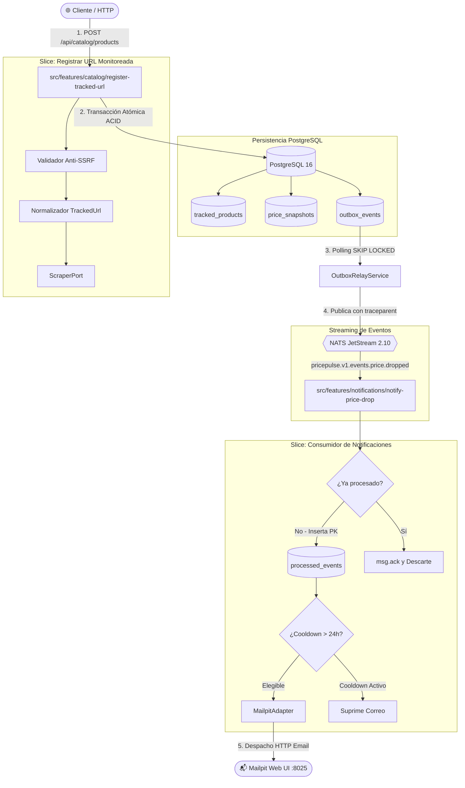

# PricePulse — Motor VSA de Nivel Producción

<p align="center">
  <strong>🌐 Idioma / Language:</strong> <a href="./README.md">English</a> | <strong>Español</strong>
  &nbsp;&bull;&nbsp;
  <a href="./CHANGELOG.es.md">Registro de Cambios</a>
  &nbsp;&bull;&nbsp;
  <a href="./CONTRIBUTING.es.md">Cómo Contribuir</a>
  &nbsp;&bull;&nbsp;
  <a href="./SEED.md">Especificación SEED</a>
</p>

<p align="center">
  
  
  
  
  
  
  
  
  
  
  
  
</p>

---

## 🎯 Resumen Ejecutivo y Propósito

**PricePulse** es un motor distribuido de monitoreo de precios de e-commerce y alertas reactivas diseñado con estándares de producción. Sirve como implementación de referencia arquitectónica para demostrar cómo construir sistemas desacoplados y resilientes utilizando **Vertical Slice Architecture (VSA)** y **Gobernanza de Desarrollo con IA**.

En lugar de dispersar las funcionalidades horizontalmente a través de capas artificiales (controladores, servicios, repositorios genéricos), cada caso de uso de negocio en PricePulse está encapsulado en una rebanada vertical autocontenida con **cero acoplamiento entre slices**.

---

## 🏗️ Topología Arquitectónica y Flujo del Sistema



---

## 💎 Aspectos Destacados de Ingeniería (Nivel MAANG)

### 1. Vertical Slice Architecture (Cero Imports Cruzados)
- **Alta Cohesión, Bajo Acoplamiento:** Cada slice contiene su propio DTO (`Zod`), Endpoint/Consumer, Handler (con SQL directo en Drizzle), Módulo y Suite de Integración con Vitest.
- **Linter de Arquitectura (`.dependency-cruiser.cjs`):** Un análisis estático automatizado corre en cada build (`pnpm depcruise`). Si algún slice importa código de otro slice, la compilación falla inmediatamente.

### 2. Patrón Transactional Outbox
- Resuelve el problema del *dual-write* distribuido. El estado de negocio y los eventos de dominio se persisten en la **misma transacción ACID**.
- **Outbox Relay:** Un worker en segundo plano consulta `outbox_events` mediante `SELECT ... FOR UPDATE SKIP LOCKED` y publica hacia NATS JetStream aplicando **retroceso exponencial** ante fallos transitorios de red.

### 3. Idempotencia en Consumidores (*Entrega Effectively-Once*)
- NATS JetStream garantiza entrega *al menos una vez* (*at-least-once*).
- Los consumidores aplican deduplicación atómica respaldada por `processed_events (event_id, consumer_name)`. Los mensajes duplicados de red se confirman (`msg.ack()`) y descartan antes de ejecutar cualquier efecto secundario.

### 4. Scraping Distribuido con BullMQ y Valkey
- Las tareas de scraping programadas corren como **trabajos repetitivos distribuidos** cada 4 horas (`repeat: { every: 14400000 }`), evitando sobrecargas repentinas en la base de datos.
- La concurrencia y la limitación de tasa por ventana deslizante en Valkey protegen contra bloqueos de IP.

### 5. Seguridad Defensiva: Anti-SSRF Recursivo
- Todas las URLs ingresadas pasan por validación estricta de protocolo y pre-resolución de DNS contra rangos privados/loopback (`127.0.0.0/8`, `10.0.0.0/8`, `192.168.0.0/16`, `169.254.0.0/16`).
- **Protección contra Redirecciones:** Inspecciona de forma recursiva los saltos HTTP 301/302, validando el destino de cada cabecera `Location` para impedir evasiones de SSRF mediante redirects.

### 6. Observabilidad Distribuida (OpenTelemetry y Jaeger)
- **Trazabilidad W3C:** Se genera un `traceId` / `traceparent` único en el borde HTTP, se almacena en PostgreSQL, viaja en las cabeceras de NATS y se registra en los logs de los consumidores.
- **Jaeger All-in-One:** Inspección visual de trazas distribuidas en cascada disponible en `http://localhost:16686`.

### 7. Prevención de Fatiga de Alertas (Cooldown de 24h)
- Los usuarios reciben correos solo una vez cada 24 horas por una misma caída de precio, a menos que el precio baje aún más, protegiendo su bandeja de entrada de spam repetitivo.

---

## 📁 Estructura del Repositorio

```
src/
├── shared/                             # Kernel transversal y primitivas de infraestructura
│   ├── domain/                         # Value Objects (Money, TrackedUrl, Result)
│   ├── ports/                          # Puertos secundarios (ScraperPort, NotificationPort)
│   ├── infra/
│   │   ├── database/                   # Cliente Drizzle, schema maestro y migraciones
│   │   ├── nats/                       # Cliente NATS JetStream y bootstrap service
│   │   ├── valkey/                     # Conexión Valkey y colas BullMQ
│   │   ├── outbox/                     # Worker de Outbox Relay
│   │   ├── notifications/              # Adaptador Mailpit y plantilla HTML de correo
│   │   ├── observability/              # SDK de OpenTelemetry y trazas W3C
│   │   └── security/                   # Validador Anti-SSRF y rate limiters
│   └── shared.module.ts                # Módulo global compartido
├── features/                           # Vertical Slices autocontenidos
│   ├── _template/health-check/         # Golden Slice (Sondas de liveness y readiness)
│   ├── catalog/register-tracked-url/   # HTTP Command: Normalización y alta de URL
│   ├── alerts/create-user-alert/       # HTTP Command: Suscripción a alerta de precio
│   ├── ingestion/record-snapshot/      # HTTP/Internal: Ingesta de snapshot y detección de caída
│   ├── scraping/schedule-url-scrape/   # BullMQ Job: Scraping periódico con rate-limit
│   └── notifications/notify-drop/      # NATS Consumer: Envío idempotente de correos
├── app.module.ts                       # Ensamblador estático (sin escaneos dinámicos en runtime)
└── main.ts                             # Bootstrap de NestJS con OpenTelemetry y Swagger
```

---

## ⚡ Inicio Rápido en 3 Minutos

### Requisitos Previos
- Node.js `v20+` o `v22+`
- `pnpm` (`v10+`)
- Docker Desktop iniciado y activo

### 1. Clonar e Instalar Dependencias
```bash
git clone https://github.com/manuelguerreroi/pricepulse-vsa.git
cd pricepulse-vsa
pnpm install
```

### 2. Levantar la Infraestructura
```bash
# Inicia Postgres 16, Valkey 8, NATS JetStream, Mailpit y Jaeger
pnpm docker:up
```

### 3. Aplicar Migraciones en PostgreSQL
```bash
pnpm db:migrate
```

### 4. Ejecutar Pruebas Automatizadas
```bash
# Pruebas unitarias
pnpm test

# Pruebas de integración contra contenedores Docker (21 pruebas)
pnpm test:integration

# Auditoría de reglas de arquitectura
pnpm depcruise
```

### 5. Iniciar la Aplicación en Desarrollo
```bash
pnpm start:dev
```

---

## 🖥️ Interfaces Web Interactivas

| Herramienta / Interfaz | URL Local | Propósito |
|---|---|---|
| **Swagger UI** | [http://localhost:3333/api/docs](http://localhost:3333/api/docs) | Exploración y ejecución interactiva de la API |
| **Dashboard Grafana** | [http://localhost:3100](http://localhost:3100) | Panel unificado preconfigurado con métricas, trazas Jaeger y datos de Postgres |
| **Buzón Mailpit** | [http://localhost:8025](http://localhost:8025) | Bandeja de entrada visual de correos HTML en tiempo real |
| **Trazas Jaeger** | [http://localhost:16686](http://localhost:16686) | Gráficos en cascada de trazas OpenTelemetry |
| **Prometheus** | [http://localhost:9090](http://localhost:9090) | Motor de métricas y recolector Prometheus |
| **Consola NATS** | [http://localhost:8222](http://localhost:8222) | Monitoreo en vivo de JetStream y métricas de mensajes |
| **Drizzle Studio** | `pnpm db:studio` -> [http://localhost:4983](http://localhost:4983) | Explorador visual de base de datos PostgreSQL |

---

## 🚫 Non-Goals Explícitos (Fuera de Alcance Deliberado)

Para proteger el foco en la arquitectura distribuida sin código de relleno:
1. **Sin Autenticación Tradicional JWT/Password:** Modelo *Guest-First* vía email protegido por Rate Limiting por IP.
2. **Sin Malla de Microservicios Pesada:** Construido como un Monolito Modular de alto rendimiento.
3. **Sin Navegadores Headless (Puppeteer/Playwright):** Scraping rápido vía HTTP con Cheerio, microdatos Schema.org y adaptadores mockeables.
4. **Sin Pasarelas de Pago:** Monitoreo y alertas; no procesamiento de compras.

---

## 📜 Licencia
MIT © [Manuel Guerrero Inostroza](https://github.com/manuelguerreroi)
