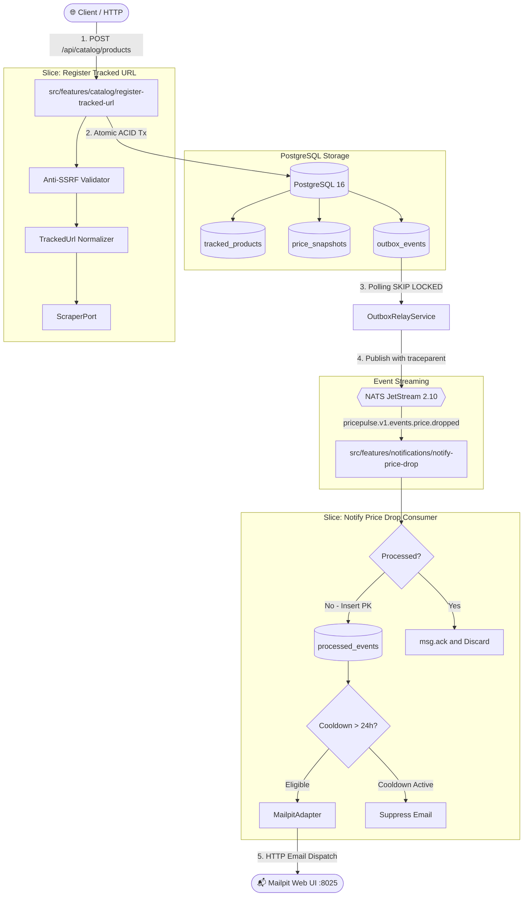

# PricePulse — Production-Grade VSA Engine

<p align="center">
  <strong>🌐 Language / Idioma:</strong> <strong>English</strong> | <a href="./README.es.md">Español</a>
  &nbsp;&bull;&nbsp;
  <a href="./CHANGELOG.md">Changelog</a>
  &nbsp;&bull;&nbsp;
  <a href="./CONTRIBUTING.md">Contributing</a>
  &nbsp;&bull;&nbsp;
  <a href="./SEED.md">Architecture SEED</a>
</p>

<p align="center">
  
  
  
  
  
  
  
  
  
  
  
  
</p>

---

## 🎯 Executive Summary & Purpose

**PricePulse** is a distributed, production-grade e-commerce price tracking and reactive alert engine. It serves as an architectural reference implementation demonstrating how to build resilient, distributed systems using **Vertical Slice Architecture (VSA)** and **AI-First Engineering Governance**.

Instead of spreading features horizontally across artificial layers (controllers, services, repositories), every single business use case in PricePulse is packaged as an isolated, self-contained vertical slice with **zero cross-slice coupling**.

---

## 🏗️ Architectural Topology & System Flow



---

## 💎 Core Engineering Highlights (MAANG-Level)

### 1. Vertical Slice Architecture (Zero Cross-Slice Imports)
- **High Cohesion, Low Coupling:** Each slice contains its own DTO (`Zod`), Endpoint/Consumer, Handler, Module, and Vitest Integration Test.
- **Architectural Linter (`.dependency-cruiser.cjs`):** Automated static analysis runs on every build (`pnpm depcruise`). If any slice imports code from another slice, the build immediately fails.

### 2. Transactional Outbox Pattern
- Solves the distributed *dual-write* problem. Business state and domain events are persisted in the **same ACID transaction**.
- **Outbox Relay:** A non-blocking background worker polls `outbox_events` using `SELECT ... FOR UPDATE SKIP LOCKED` and publishes to NATS JetStream with **exponential backoff** on transient failures.

### 3. Consumer Idempotency (*Effectively-Once Delivery*)
- NATS JetStream provides *at-least-once* delivery.
- Consumers execute atomic deduplication backed by `processed_events (event_id, consumer_name)`. Duplicate network messages are acknowledged (`msg.ack()`) and discarded before executing any side effects.

### 4. Distributed Scraping with BullMQ & Valkey
- Scheduled scraping jobs run as **distributed repeatable jobs** every 4 hours (`repeat: { every: 14400000 }`), preventing database cron spikes.
- Concurrency and sliding-window rate limiting per domain protect against IP blocking.

### 5. Defensive Security: Recursive Anti-SSRF
- All user-supplied URLs undergo strict protocol verification and DNS pre-resolution against private/loopback CIDRs (`127.0.0.0/8`, `10.0.0.0/8`, `192.168.0.0/16`, `169.254.0.0/16`).
- **HTTP Redirect Protection:** Follows 301/302 redirects recursively, inspecting each `Location` header to prevent redirect-based SSRF bypasses.

### 6. Distributed Observability (OpenTelemetry & Jaeger)
- **W3C TraceContext:** A unique `traceId` / `traceparent` is injected at the HTTP boundary, stored in PostgreSQL, forwarded through NATS message headers, and logged in consumer events.
- **Jaeger All-in-One:** Live distributed waterfall trace inspection available at `http://localhost:16686`.

### 7. Notification Fatigue Protection (24h Cooldown)
- Users receive alerts only once per 24-hour window for a given price drop, unless the price drops even further, preventing email inbox spam.

---

## 📁 Repository Structure

```
src/
├── shared/                             # Kernel transversal and infrastructure primitives
│   ├── domain/                         # Value Objects (Money, TrackedUrl, Result)
│   ├── ports/                          # Secondary Ports (ScraperPort, NotificationPort)
│   ├── infra/
│   │   ├── database/                   # Drizzle client, master schema, and migrations
│   │   ├── nats/                       # NATS JetStream client and bootstrap service
│   │   ├── valkey/                     # Valkey connection and BullMQ queues
│   │   ├── outbox/                     # Transactional Outbox Relay worker
│   │   ├── notifications/              # Mailpit adapter and responsive email template
│   │   ├── observability/              # OpenTelemetry SDK and W3C tracing
│   │   └── security/                   # Anti-SSRF validator and rate limiters
│   └── shared.module.ts                # Global shared module
├── features/                           # Self-contained Vertical Slices
│   ├── _template/health-check/         # Golden Slice (Liveness & Readiness probes)
│   ├── catalog/register-tracked-url/   # HTTP Command: URL normalization & registration
│   ├── alerts/create-user-alert/       # HTTP Command: Price drop alert subscription
│   ├── ingestion/record-snapshot/      # HTTP/Internal: Snapshot ingesta & price drop check
│   ├── scraping/schedule-url-scrape/   # BullMQ Job: Rate-limited background scraping
│   └── notifications/notify-drop/      # NATS Consumer: Idempotent email dispatch
├── app.module.ts                       # Static assembler (no dynamic runtime globs)
└── main.ts                             # NestJS bootstrap with OpenTelemetry & Swagger
```

---

## ⚡ Quickstart in 3 Minutes

### Prerequisites
- Node.js `v20+` or `v22+`
- `pnpm` (`v10+`)
- Docker Desktop active

### 1. Clone & Install Dependencies
```bash
git clone https://github.com/manuelguerreroi/pricepulse-vsa.git
cd pricepulse-vsa
pnpm install
```

### 2. Start Infrastructure
```bash
# Spins up Postgres 16, Valkey 8, NATS JetStream, Mailpit, and Jaeger
pnpm docker:up
```

### 3. Run Database Migrations
```bash
pnpm db:migrate
```

### 4. Run Test Suites
```bash
# Unit tests
pnpm test

# Integration tests against Docker containers
pnpm test:integration

# Architecture governance linter
pnpm depcruise
```

### 5. Launch Application
```bash
pnpm start:dev
```

---

## 🖥️ Interactive Web Interfaces

| Tool / Interface | URL | Purpose |
|---|---|---|
| **Swagger UI** | [http://localhost:3333/api/docs](http://localhost:3333/api/docs) | Interactive API exploration and testing |
| **Grafana Dashboard** | [http://localhost:3100](http://localhost:3100) | Pre-configured unified dashboard with Prometheus, Jaeger & Postgres |
| **Mailpit Mailbox** | [http://localhost:8025](http://localhost:8025) | Live inbox inspecting rendered HTML alert emails |
| **Jaeger Tracing** | [http://localhost:16686](http://localhost:16686) | Distributed OpenTelemetry trace waterfall |
| **Prometheus** | [http://localhost:9090](http://localhost:9090) | Prometheus metrics scraper and query engine |
| **NATS Dashboard** | [http://localhost:8222](http://localhost:8222) | Real-time JetStream monitoring & message metrics |
| **Drizzle Studio** | `pnpm db:studio` -> [http://localhost:4983](http://localhost:4983) | Visual database browser for PostgreSQL |

---

## 🚫 Explicit Non-Goals (Out of Scope by Design)

To protect focus on distributed architecture and VSA without unnecessary boilerplate:
1. **No Traditional JWT/Password Auth:** Guest-first email model with sliding-window IP rate limiting.
2. **No Heavy Microservices Mesh:** Built as an enterprise Modular Monolith.
3. **No Headless Browsers (Puppeteer/Playwright):** Fast HTTP-based scraping via Cheerio, Schema.org JSON-LD, and mock adapters.
4. **No Payments/Checkout:** Monitoring and alerting only.

---

## 📜 License
MIT © [Manuel Guerrero Inostroza](https://github.com/manuelguerreroi)
